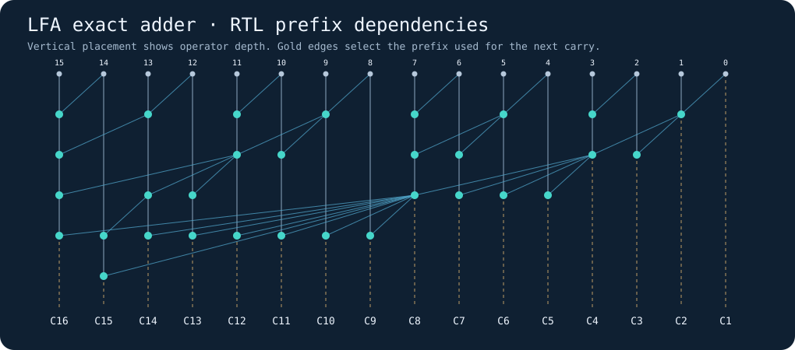
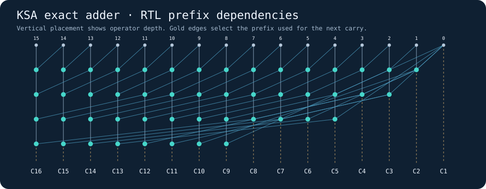
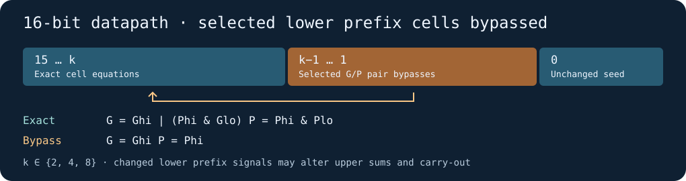
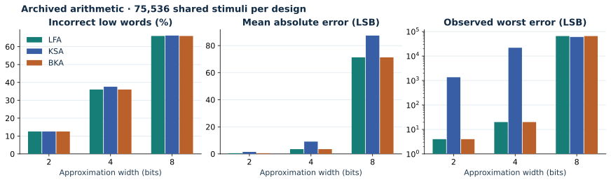
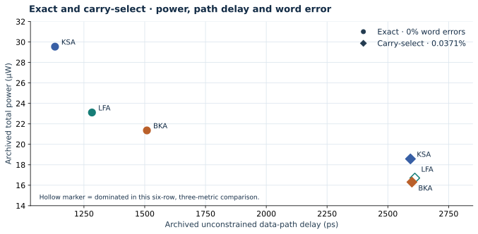
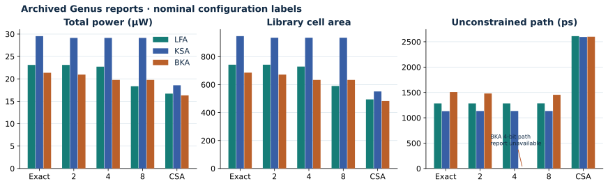
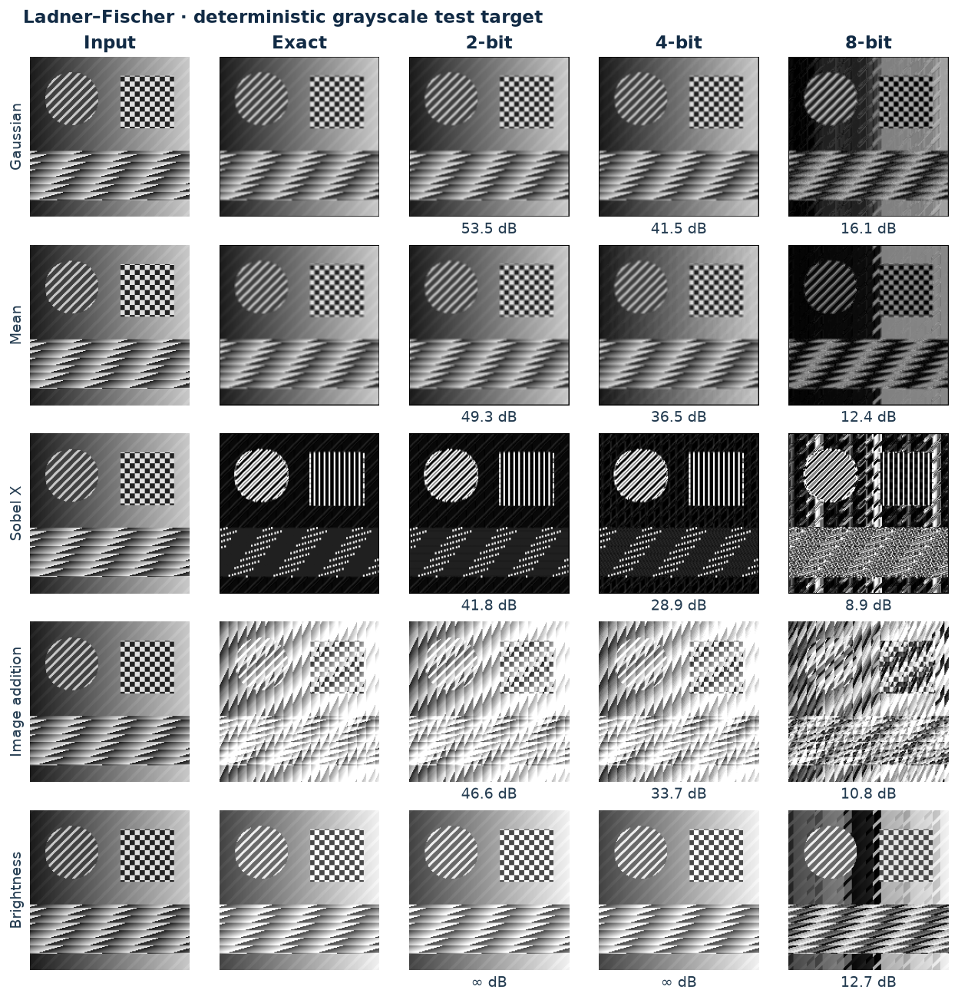
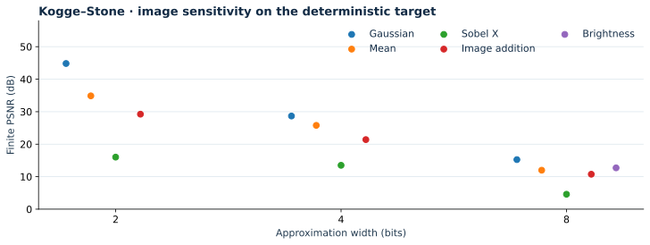

# Exact and Approximate 16-bit Parallel-Prefix Adders for Digital Image Processing

This engineering study compares three Verilog carry networks across exact addition, three levels of lower-order prefix approximation, and a speculative carry-select design. It connects post-synthesis hardware reports to bit-accurate arithmetic replay and grayscale image processing.

**15 RTL configurations · 75,536 shared historical inputs · 1,198,800 fresh RTL evaluations · 5 image operations**

**Carry-select highlight:** Each architecture produced **28 incorrect 17-bit words** out of **75,536** historical inputs (**0.03707%** word error rate) and **61 mismatched output bits** out of **1,284,112** (**0.004750%** bit error rate). The **10,000-row** full-width tail (which includes both `Cin = 0` and `Cin = 1`) had a **0.28000%** word error rate (`28 / 10,000`), with all **28** errors occurring among the **5,071** `Cin = 1` cases (**0.55216%**); the **65,536** exhaustive byte-pair inputs fixed `Cin = 0` and produced zero carry-select errors. Against each architecture's exact Genus baseline, carry-select saves **27.72%** (Ladner–Fischer), **37.13%** (Kogge–Stone), and **23.64%** (Brent–Kung) of reported total power, with **72–129% longer** unconstrained data paths.

---

## Design matrix

| Architecture | Exact | 2-bit | 4-bit | 8-bit | Carry-select |
|---|---|---|---|---|---|
| Ladner–Fischer | [ladner](rtl/lfa/exact.v) | [ladnerapprox2](rtl/lfa/2.v) | [ladner_fig8](rtl/lfa/4.v) | [ladner_fig8](rtl/lfa/8.v) | [ladner_fig8_m1](rtl/lfa/csa.v) |
| Kogge–Stone | [kogge_stone_fig4](rtl/ksa/exact.v) | [kogge_stone_fig4](rtl/ksa/2.v) | [kogge_stone_fig4](rtl/ksa/4.v) | [kogge_stone_fig4](rtl/ksa/8.v) | [ksa_csa](rtl/ksa/csa.v) |
| Brent–Kung | [Brkung](rtl/bka/exact.v) | [BKapprox2](rtl/bka/2.v) | [BKapprox4](rtl/bka/4.v) | [BKapprox8](rtl/bka/8.v) | [bka_csa](rtl/bka/csa.v) |

Each configuration accepts two unsigned 16-bit words and one carry-in. The full result is `{Cout, Sum[15:0]}`. Historical worksheets retain the low word. Compile one configuration at a time because archived files reuse top and helper module names. [Design inventory](results/design_inventory.csv)

## Prefix logic and approximation

The designs first compute `p[i] = A[i] ^ B[i]` and `g[i] = A[i] & B[i]`. Exact prefix cells combine adjacent generate/propagate pairs. A selected low-order cell in an approximate configuration forwards both signals from its higher-index input, discarding the lower-index contribution at that cell. All variants retain XOR sum generation. Changed carry values can propagate into the upper word and affect `Cout`.

The recovered exact networks use 31, 49, and 26 prefix cells for Ladner–Fischer, Kogge–Stone, and Brent–Kung, respectively. Their deepest carry prefixes contain 5, 4, and 6 combine operations. Overlapping Kogge–Stone groups can feed different carry outputs with different discarded contributions, explaining why matching error rates can coexist with sharply different error magnitudes. [All three exact graphs and Boolean derivation](docs/ARCHITECTURE.md)

### Ladner–Fischer



### Kogge–Stone



### Brent–Kung




The 8+8 speculative carry-select variants compute both upper candidate sums and select using the lower byte's generate signal (`G_final[7]`). This omits the effect of `Cin` on selection when the lower byte propagates through all eight bits, shifting the full 17-bit result by `−256` in **28** historical cases per architecture.

## Arithmetic verification

The historical inputs consist of **65,536** ordered 8-bit operand pairs (`Cin = 0`), followed by **10,000** full-width cases covering both `Cin = 0` and `Cin = 1` (**5,071** `Cin = 1` rows). Twelve worksheet exports cover 906,432 recorded output rows. Icarus replay added 288 directed and 4,096 seeded random vectors per design (1,198,800 evaluations). The three exact adders passed all full-width checks, and all nine width-based variants reproduced their archived low words on all 75,536 inputs.

| Architecture | 2-bit error / MAE | 4-bit error / MAE | 8-bit error / MAE |
|---|---:|---:|---:|
| Ladner–Fischer | 12.54% / 0.502 | 36.03% / 3.507 | 65.96% / 71.313 |
| Kogge–Stone | 12.54% / 1.465 | 37.59% / 9.113 | 66.20% / 87.386 |
| Brent–Kung | 12.54% / 0.502 | 36.03% / 3.507 | 65.96% / 71.313 |

MAE is measured in integer LSB units on the recorded low words. The 8-bit Ladner–Fischer and Brent–Kung rows reach a low-word distance of 65,496 at the wrap between 65,535 and 0; their maximum full 17-bit distance on the fresh replay suite was 340. The archived Brent–Kung carry-select workbook duplicates the Brent–Kung 4-bit output rows and differs from fresh BKA CSA RTL replay on 27,244 rows; its reproduction status appears in the [replay table](results/rtl_replay.csv). [Input coverage, formulas and metrics](docs/VERIFICATION.md)

### Carry-select error rates

All three carry-select configurations produced identical error counts and rates in these experiments. The word rate counts any mismatch in the 17-bit output, and the bit rate counts individual mismatched bits across all 17 positions including `Cout`.

| Stimulus set | Word errors | Word error rate | Bit errors | Bit error rate |
|---|---:|---:|---:|---:|
| Historical suite (75,536) | 28 | 0.03707% | 61 / 1,284,112 | 0.004750% |
| Historical full-width tail (10,000, both `Cin`) | 28 | 0.28000% | 61 / 170,000 | 0.035882% |
| Historical full-width `Cin = 1` subset (5,071) | 28 | 0.55216% | 61 / 86,207 | 0.070760% |
| Historical, directed and seeded cases (79,920) | 46 | 0.05756% | 134 / 1,358,640 | 0.009863% |

The 65,536 exhaustive byte-pair inputs fixed `Cin = 0` and produced zero carry-select errors. [Carry-select accuracy data](results/carry_select_accuracy.csv)




## ASIC synthesis evidence

The comparative archive contains Cadence Genus 21.14-s082_1 reports under a slow condition and an enclosed wireload mode. The Ladner–Fischer 8-bit-labeled report records 18.345 µW versus 23.109 µW for exact (a 20.62% decrease), and reported library cell area drops from 742.519 to 590.382 (a 20.49% decrease), while the first unconstrained path remains `B[9] → Sum[15]` (`1,283 → 1,284 ps`).

The Kogge–Stone exact report has the shortest recorded baseline path at 1,131 ps, and the Brent–Kung exact report has the lowest baseline area and total power. Several archived report labels conflict with their internal top-module names, which limits per-width attribution. [Genus report audit and conditions](docs/SYNTHESIS.md)

### Carry-select power savings vs. exact baseline

| Architecture | Exact power (µW) | Carry-select power (µW) | Power saved | Cell area saved | Data path (ps), exact → carry-select |
|---|---:|---:|---:|---:|---:|
| Ladner–Fischer | 23.109 | 16.704 | **27.72%** | 33.44% | 1,283 → 2,611 |
| Kogge–Stone | 29.543 | 18.574 | **37.13%** | 41.81% | 1,131 → 2,593 |
| Brent–Kung | 21.358 | 16.308 | **23.64%** | 29.58% | 1,509 → 2,599 |

These savings use each architecture's archived exact report as its denominator. The carry-select data paths are **72–129% longer**. The Pareto comparison minimizes total power, unconstrained path delay, and replay word error across the six exact and carry-select points. [Trade-off data](results/carry_select_tradeoffs.csv)





## Reproduce the image experiments

The original MATLAB/Verilog image-processing codebase covers **Gaussian** and **mean** filters, **horizontal Sobel**, **saturated pixel addition**, and **brightness adjustment** (no separate pixel-wise image multiplication implementation or output was recovered). Historical third-party benchmark captures (derived from Lena, Rice, and a cat photograph) remain excluded from this public repository pending redistribution clearance.

To provide raw raster outputs, bit-accurate source-model linkage, and license-free reproducibility, the repository includes a deterministic grayscale demonstration (`scripts/images.py`) checked against Icarus Verilog on all 79,920 stimuli per design. It evaluates all 15 configurations across all 5 operations (`75` outputs, `results/image_demo.csv`):

- 8-bit Ladner–Fischer drops from **53.54 dB** (2-bit) to **16.14 dB** (8-bit) on Gaussian filtering, and from **41.79 dB** to **8.87 dB** on horizontal Sobel.





[Application inventory, algorithms and quality metrics](docs/IMAGING.md) · [Reproducible 75-image gallery](docs/IMAGE_GALLERY.md) · [Run the experiments](docs/REPRODUCE.md)

## Run the analysis

```sh
python scripts/arithmetic.py
python -m pip install -r requirements.txt
python scripts/arithmetic.py --simulate
python scripts/prefix.py
python scripts/images.py
python scripts/plots.py
python scripts/carry_select.py
python scripts/carry_select_plots.py
```

The simulation step uses Icarus Verilog. Archived CSV exports, design files, and generated results are under [datasets](datasets/arithmetic), [RTL](rtl), and [results](results). [Commands and dependencies](docs/REPRODUCE.md)

## Academic context

The original student project, *Design and Implementation of Approximate 16 Bit Ladner Fischer Adder*, was completed in Electronics and Communication Engineering at JSS Academy of Technical Education, Bengaluru, under the guidance of Mrs. Sunitha L. Shirahatti. The archive credits Ananya S, Apoorva Sheshadri, K S Sindhura, and Likhith B ([LikhithB05](https://github.com/LikhithB05)). [Attribution](AUTHORS.md)
