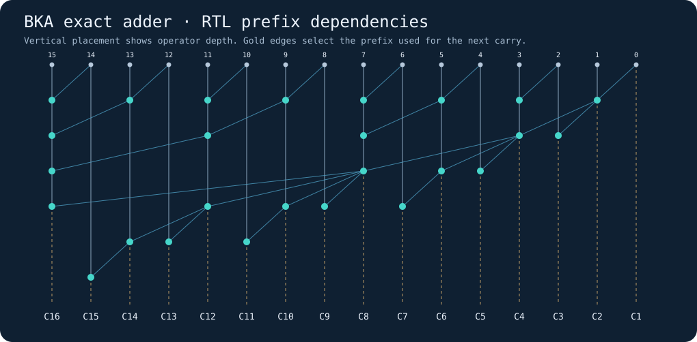
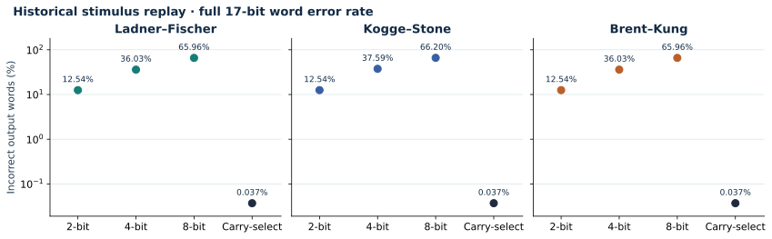
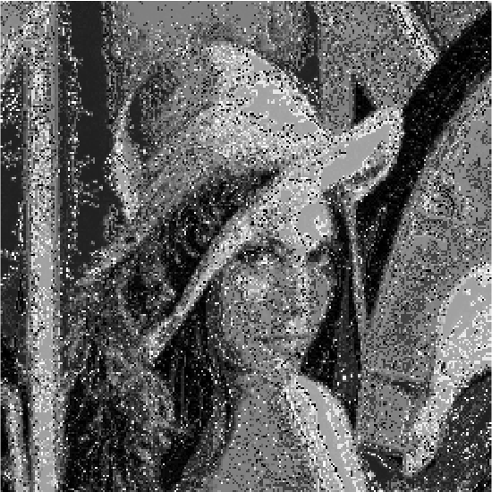
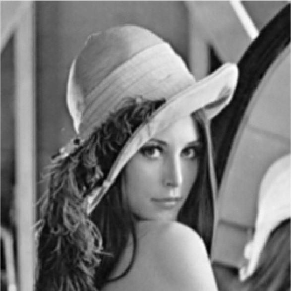
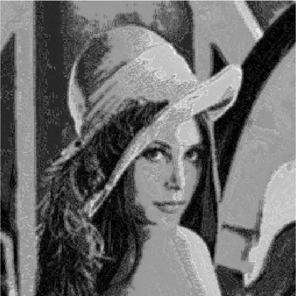
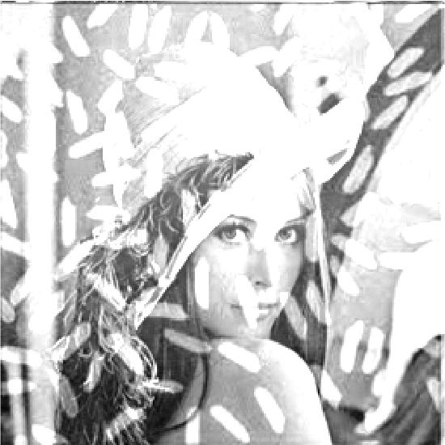
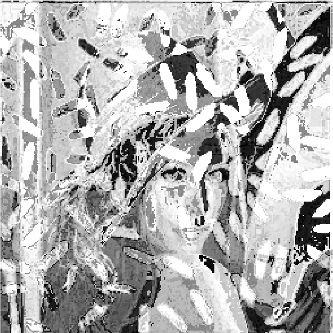

# Exact and Approximate 16-bit Parallel-Prefix Adders for Digital Image Processing

This engineering study compares three Verilog carry networks across exact addition, three levels of lower-order prefix approximation, and a speculative carry-select design. It connects post-synthesis hardware reports to bit-accurate arithmetic replay and grayscale image processing.

**15 RTL configurations · 75,536 shared historical inputs · 1,198,800 fresh RTL evaluations · 5 image operations**

**Carry-select highlight:** Each architecture had 28 incorrect 17-bit words in 75,536 historical inputs (**0.03707%** word error rate) and 61 mismatched output bits out of 1,284,112 (**0.004750%** bit error rate). Across the 10,000-row full-width tail (covering both `Cin = 0` and `Cin = 1`), the word error rate is **0.28000%** (`28 / 10,000`), with all 28 errors occurring among the 5,071 `Cin = 1` cases (**0.55216%**). The comparative Genus reports record **23.64–37.13% lower total power** for carry-select than for the corresponding exact baselines, with longer data paths.

## Design matrix

| Architecture | Exact | 2-bit | 4-bit | 8-bit | Carry-select |
|---|---|---|---|---|---|
| Ladner–Fischer | [ladner](rtl/lfa/exact.v) | [ladnerapprox2](rtl/lfa/2.v) | [ladner_fig8](rtl/lfa/4.v) | [ladner_fig8](rtl/lfa/8.v) | [ladner_fig8_m1](rtl/lfa/csa.v) |
| Kogge–Stone | [kogge_stone_fig4](rtl/ksa/exact.v) | [kogge_stone_fig4](rtl/ksa/2.v) | [kogge_stone_fig4](rtl/ksa/4.v) | [kogge_stone_fig4](rtl/ksa/8.v) | [ksa_csa](rtl/ksa/csa.v) |
| Brent–Kung | [Brkung](rtl/bka/exact.v) | [BKapprox2](rtl/bka/2.v) | [BKapprox4](rtl/bka/4.v) | [BKapprox8](rtl/bka/8.v) | [bka_csa](rtl/bka/csa.v) |

Each configuration accepts two unsigned 16-bit words and one carry-in. The full result is `{Cout, Sum[15:0]}`. Historical worksheets retain the low word. Compile one configuration at a time because the archived files reuse top and helper module names. [Design inventory](results/design_inventory.csv)

## Prefix logic and approximation

The designs first compute `p[i] = A[i] ^ B[i]` and `g[i] = A[i] & B[i]`. Exact prefix cells combine adjacent generate/propagate pairs. A selected low-order cell in an approximate configuration forwards both signals from its higher-index input, discarding the lower-index contribution at that cell. All variants retain XOR sum generation. Changed carry values can propagate into the upper word and affect `Cout`.

The recovered exact networks use 31, 49 and 26 prefix cells for Ladner–Fischer, Kogge–Stone and Brent–Kung, respectively. Their deepest carry prefixes contain 5, 4 and 6 combine operations. Overlapping Kogge–Stone groups can feed different carry outputs with different discarded contributions. This explains why matching error rates can coexist with sharply different error magnitudes. [All three exact graphs and Boolean derivation](docs/ARCHITECTURE.md)

### Ladner–Fischer


### Kogge–Stone


### Brent–Kung




The 8+8 carry-select variants compute both upper candidate sums and select using the lower byte’s generate signal. This omits the effect of `Cin` on selection when the lower byte propagates through all eight bits. The full result then falls short by 256. The fresh replay found 28 such historical cases per architecture.

## Arithmetic verification

The historical inputs consist of all 65,536 ordered 8-bit operand pairs with carry-in zero, followed by 10,000 full-width, random-looking cases with both carry-in values. Twelve worksheet exports cover 906,432 recorded output rows. Icarus replay added 288 directed and 4,096 seeded random vectors per design. The three exact adders passed all full-width checks. All nine width-based variants reproduced their archived low words on all 75,536 inputs.

| Architecture | 2-bit error / MAE | 4-bit error / MAE | 8-bit error / MAE |
|---|---:|---:|---:|
| Ladner–Fischer | 12.54% / 0.502 | 36.03% / 3.507 | 65.96% / 71.313 |
| Kogge–Stone | 12.54% / 1.465 | 37.59% / 9.113 | 66.20% / 87.386 |
| Brent–Kung | 12.54% / 0.502 | 36.03% / 3.507 | 65.96% / 71.313 |

MAE is measured in integer LSB units on the recorded low words. The 8-bit Ladner–Fischer and Brent–Kung rows reach a low-word distance of 65,496 at the wrap between 65,535 and 0. Their maximum full 17-bit distance on the fresh replay suite was 340. The archived Brent–Kung carry-select workbook duplicates the Brent–Kung 4-bit output rows. Its reproduction status appears in the [replay table](results/rtl_replay.csv). [Input coverage, formulas and metrics](docs/VERIFICATION.md)

### Carry-select error rates

All three carry-select configurations produced the same rates in these experiments. The word rate counts any mismatch in the 17-bit output. The bit rate counts individual mismatched bits across all 17 positions, including carry-out.

| Stimulus set | Word errors | Word error rate | Bit errors | Bit error rate |
|---|---:|---:|---:|---:|
| Historical suite (75,536) | 28 | 0.03707% | 61 / 1,284,112 | 0.004750% |
| Historical full-width tail (10,000, both `Cin`) | 28 | 0.28000% | 61 / 170,000 | 0.035882% |
| Historical full-width `Cin = 1` subset (5,071) | 28 | 0.55216% | 61 / 86,207 | 0.070760% |
| Historical, directed and seeded cases (79,920) | 46 | 0.05756% | 134 / 1,358,640 | 0.009863% |

The 65,536 cases in the exhaustive byte sweep have `Cin=0` and produce zero carry-select errors. The full-width tail gives a separate view of accuracy when the inputs also exercise `Cin=1`. [Carry-select accuracy data](results/carry_select_accuracy.csv)



[Error magnitude and worst observed low-word error](assets/arithmetic.svg)

## ASIC synthesis evidence

The comparative archive contains Cadence Genus 21.14-s082_1 reports under a slow condition and an enclosed wireload mode. The Ladner–Fischer 8-bit-labeled report records 18.345 µW versus 23.109 µW for exact, a 20.62% decrease. Reported library cell area drops from 742.519 to 590.382, a 20.49% decrease. The first unconstrained path remains at `B[9] → Sum[15]` and changes from 1,283 to 1,284 ps. The retained upper-prefix path is consistent with the observed timing and reduced low-order logic.

The Kogge–Stone exact report has the shortest recorded baseline path at 1,131 ps. The Brent–Kung exact report has the lowest baseline area and total power. Several report labels conflict with their internal tops, which limits width-specific attribution. [Genus report audit and conditions](docs/SYNTHESIS.md)

### Carry-select power savings

| Architecture | Exact power (µW) | Carry-select power (µW) | Power saved | Cell area saved | Data path (ps), exact → carry-select |
|---|---:|---:|---:|---:|---:|
| Ladner–Fischer | 23.109 | 16.704 | **27.72%** | 33.44% | 1,283 → 2,611 |
| Kogge–Stone | 29.543 | 18.574 | **37.13%** | 41.81% | 1,131 → 2,593 |
| Brent–Kung | 21.358 | 16.308 | **23.64%** | 29.58% | 1,509 → 2,599 |

These savings use each architecture’s archived exact report as its denominator. Brent–Kung carry-select has the lowest reported total power and Kogge–Stone carry-select has the largest reduction relative to its own baseline. The carry-select paths are **72–129% longer**. The Pareto comparison minimizes total power, unconstrained path delay, and replay word error across the six exact and carry-select points. [Trade-off data](results/carry_select_tradeoffs.csv)


## Image processing

The original code contains Gaussian and mean filters, horizontal Sobel, saturated pixel addition and brightness adjustment. Four operations have historical MATLAB/Verilog file-exchange examples. The archive includes Lena filter results for all three architectures, five Ladner–Fischer addition outputs, and additional Kogge–Stone addition and brightness captures. The addition examples reference a Rice input. A Cameraman plot label appears in a MATLAB example that reads `pout.tif`, so it does not establish the input for an archived output. No separate pixel-wise multiplication implementation or result was located.

## Original project outputs

The Lena Gaussian figures below come from the archived runs. Each row shows one architecture. Display margins are cropped for comparison. The full gallery has the unmodified figures, including Lena mean and Sobel results.

| Architecture | Exact | 2-bit | 4-bit | 8-bit | Carry-select |
|---|---|---|---|---|---|
| Ladner–Fischer |  |  |  |  |  |
| Kogge–Stone |  |  |  |  |  |
| Brent–Kung |  |  |  |  |  |

### Original image addition

The Ladner–Fischer row includes the exact and all four approximate outputs. The file-exchange example names Lena and Rice, and the archived images show a composite. The exact input files and final run settings were unavailable.

| Architecture | Exact | 2-bit | 4-bit | 8-bit | Carry-select |
|---|---|---|---|---|---|
| Ladner–Fischer |  |  |  |  |  |

Additional Kogge–Stone addition outputs are in the full gallery. The archive supplies no matching exact capture or verified Cameraman input for that series.

[Full original image gallery](docs/ORIGINAL_BENCHMARK_GALLERY.md) · [12 original project graphs](docs/HISTORICAL_GRAPHS.md)

### Reproducible comparison

The demonstration uses a deterministic grayscale target and a source-derived software evaluator checked against Icarus on all 79,920 stimuli for each design. It preserves row-major accumulation and reports PSNR against the corresponding exact output. The 8-bit Ladner–Fischer demo dropped from 53.54 to 16.14 dB for Gaussian and from 41.79 to 8.87 dB for horizontal Sobel relative to the 2-bit configuration. Image clipping and operand structure make these trade-offs workload dependent.

[Open the deterministic grayscale comparison](assets/image-demo.png)

[Application inventory, algorithms and quality metrics](docs/IMAGING.md) · [Demonstration gallery](docs/IMAGE_GALLERY.md) · [Run the experiments](docs/REPRODUCE.md)

## Run the analysis

```sh
python scripts/arithmetic.py
python -m pip install -r requirements.txt
python scripts/arithmetic.py --simulate
python scripts/prefix.py
python scripts/images.py
python scripts/plots.py
python scripts/carry_select.py
python scripts/carry_select_plots.py
```

The simulation step uses Icarus Verilog. The archived CSV exports, design files, and generated results are under [datasets](datasets/arithmetic), [RTL](rtl) and [results](results). The reproduction guide covers individual testbenches, the Genus parser, and the archived MATLAB source examples. [Commands and dependencies](docs/REPRODUCE.md)

## Academic context

The original student project, *Design and Implementation of Approximate 16 Bit Ladner Fischer Adder*, was completed in Electronics and Communication Engineering at JSS Academy of Technical Education, Bengaluru, under the guidance of Mrs. Sunitha L. Shirahatti. The archive credits Ananya S, Apoorva Sheshadri, K S Sindhura and Likhith B. The owner, [Likhith B](https://github.com/LikhithB05), recalls developing Ladner–Fischer first and extending the investigation to the other two architectures. [Attribution](AUTHORS.md)
