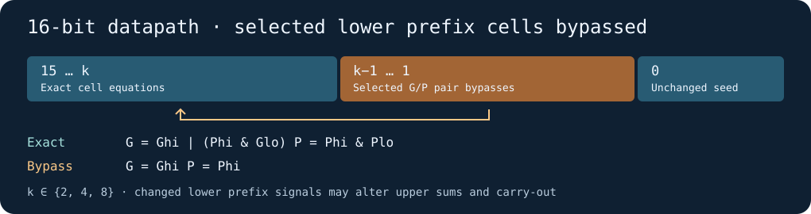

# Prefix network and approximation

## Exact datapath

A prefix node with inputs `lo` and `hi` computes `G = G_hi | (P_hi & G_lo)` and `P = P_hi & P_lo`. For every bit `i` the final prefix over `[i:0]` supplies `C[i+1] = G_final[i] | (P_final[i] & Cin)`. `C[0] = Cin`, `Sum[i] = (A[i] ^ B[i]) ^ C[i]` and `Cout = C[16]`. The source instantiates two-output G/P cells throughout the combine network. The separate carry expressions use both final signals, with no instantiated gray-cell module.

| Exact design | Combine nodes | Deepest prefix | Max consumers of a G/P pair |
|---|---:|---:|---:|
| Ladner–Fischer | 31 | 5 | 9 |
| Kogge–Stone | 49 | 4 | 5 |
| Brent–Kung | 26 | 6 | 5 |

The consumer count includes each prefix operator input plus any final carry using the pair. It excludes buffering, gate internal fan-out, synthesis changes and fan-out of `Cin`. Operator depth excludes input generation, carry-in gating and sum XOR. The graphs render the actual source dependencies, with rows grouped by longest dependency depth. [Derived node and replacement counts](../results/prefix_structure.csv)

- **Ladner–Fischer.** A four-level reduction builds complete groups at indices 1, 3, 7 and 15. Distribution around the 4-bit and 8-bit anchors uses local groups and intermediate cells such as `D_10_temp` and `D_14_temp`. In this source the reduction-plus-distribution graph has a five-operator path. [Ladner–Fischer RTL graph](../assets/lfa-exact.svg)
- **Kogge–Stone.** Four expansion stages combine spans with offsets 1, 2, 4 and 8. Early complete groups feed the corresponding final carries directly. Dense parallel work gives the shallowest prefix in this implementation and requires more group wiring. [Kogge–Stone RTL graph](../assets/ksa-exact.svg)
- **Brent–Kung.** A four-level reduction is followed by a staged distribution. For example, `D_10` uses the already distributed index-9 prefix and local bit 10. This version trades fewer cells for a deeper longest prefix. [Brent–Kung RTL graph](../assets/bka-exact.svg)

The three algorithms illustrate different choices about prefix reuse, number of operators, dependency depth and wiring. Those differences can influence mapped area, switch capacitance, and delay. The Genus data reflects particular library and mapping conditions. [Brent and Kung, A Regular Layout for Parallel Adders](https://maths-people.anu.edu.au/~brent/pub/pub060.html)

## Approximate carry cells

Selected operators in the lower `k` bit region (`k=2,4,8`) compute `(G,P)=(G_hi,P_hi)`. The bypass discards both the incoming group generate and its contribution to propagate. For the final low-region prefix ending at bit `i`, where `1 ≤ i < k`, this collapses the carry to `C[i+1]=(A[i]&B[i]) | ((A[i]^B[i])&Cin)`. This includes the boundary `C[k]`. Bit 0 and bit 1 sums use exact carries. The earliest changed sum can be bit 2.

| Variant | Cell-region boundary | First potentially affected output | Replaced cells LF / KS / BK |
|---|---:|---:|---:|
| 2-bit | `C[2]` | `Sum[2]` | 1 / 1 / 1 |
| 4-bit | `C[4]` | `Sum[2]` | 4 / 5 / 4 |
| 8-bit | `C[8]` | `Sum[2]` | 12 / 17 / 11 |

In the Ladner–Fischer and Brent–Kung implementations, the carry beyond the boundary combines exact upper subgroups with the collapsed lower prefix. Kogge–Stone’s overlapping groups include independent bypassed intermediate subgroups. Thus upper carries can disagree with the single corrected boundary model. As a concrete trace, `A=1, B=7, Cin=0` produces 12 in the 2-bit Kogge–Stone design, 4 in its Ladner–Fischer and Brent–Kung counterparts, and 8 in the exact designs. `A=AAAA_hex, B=5555_hex, Cin=1` is a useful carry-propagate stress pattern. Retaining the upper exact operator equation does not guarantee that upper output bits match the exact word.

For LFA/BKA the upper block’s numerical error contribution is the boundary-carry delta times `2^k`. Lower carry changes alter the XOR sum bits. With the high word intact as a 17-bit result, the resulting error remains localized in magnitude. Unsigned modular projection can make a small full-width discrepancy span nearly the entire 16-bit low-word range. Kogge–Stone can also create large full-width errors because the reconstructed upper bits need not encode a single shifted carry error.

## Carry-select designs

Each CSA variant computes exact low-byte sums with `Cin`. It precomputes upper sums for the two possible incoming carries using ripple candidates and selects using `G_final[7]`. Exact selection needs `G_final[7] | (P_final[7] & Cin)`. When `Cin=1` and the two low bytes sum to 255, the chosen upper word is short by one, producing a numerical error of −256 in the full word. For `Cin=0` the predictor is exact. The archive uses CSA as shorthand for carry-select in these designs. [Example CSA RTL](../rtl/lfa/csa.v)
