# Historical Mini project graphs

These are the original archived project PNGs (`END/GRAPHS/*.png`). Some labels differ from the workbook audit and fresh RTL replay:

- **MAE discrepancy:** The original LFA and BKA MAE plots show values (`1.4648`, `5.8421`, `82.9135`) that differ from the recalculated workbook low-word MAEs (`0.501695`, `3.506990`, `71.313281`).
- **Carry-select discrepancy:** The original CSA rate plots differ by architecture, whereas fresh RTL replay across the shared 75,536 historical vectors produces an identical **28 errors** (`0.03707%`) for each of Ladner–Fischer, Kogge–Stone, and Brent–Kung (all in the 5,071 `Cin = 1` tail cases, `0.55216%`).
- The main [README](../README.md) charts (`assets/error-by-architecture.svg`, `assets/arithmetic.svg`) use the audited workbook and verified RTL replay counts.

## Ladner–Fischer

| Error rate | MAE | MRED | Worst-case error |
|---|---|---|---|
| 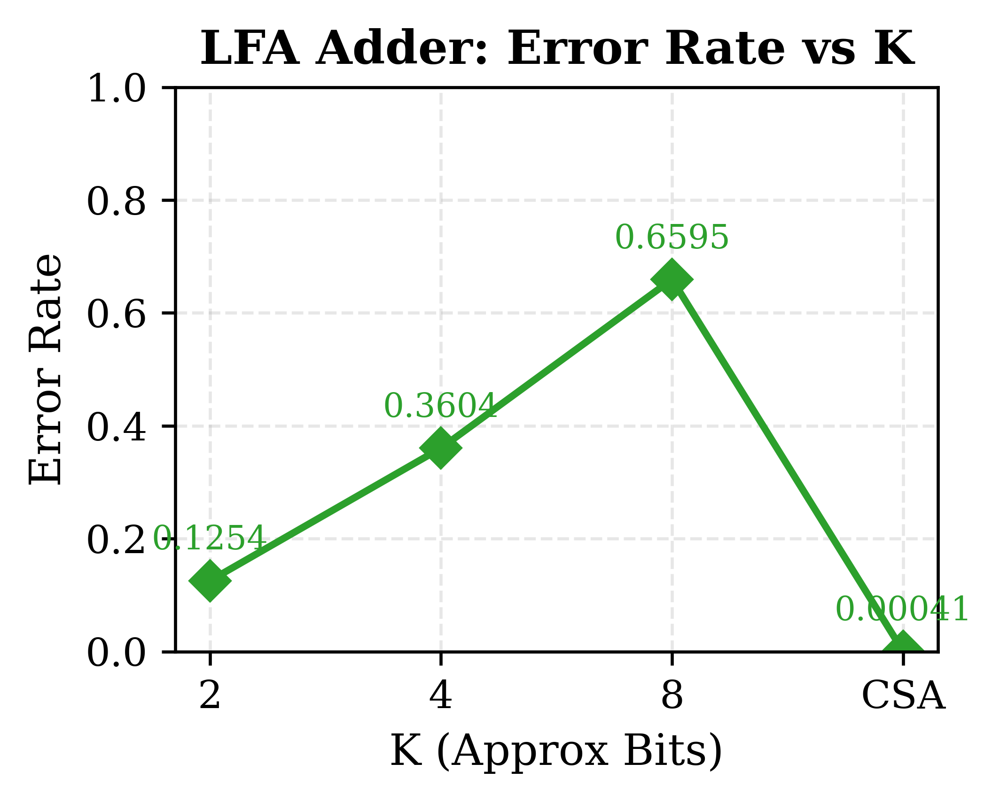 | 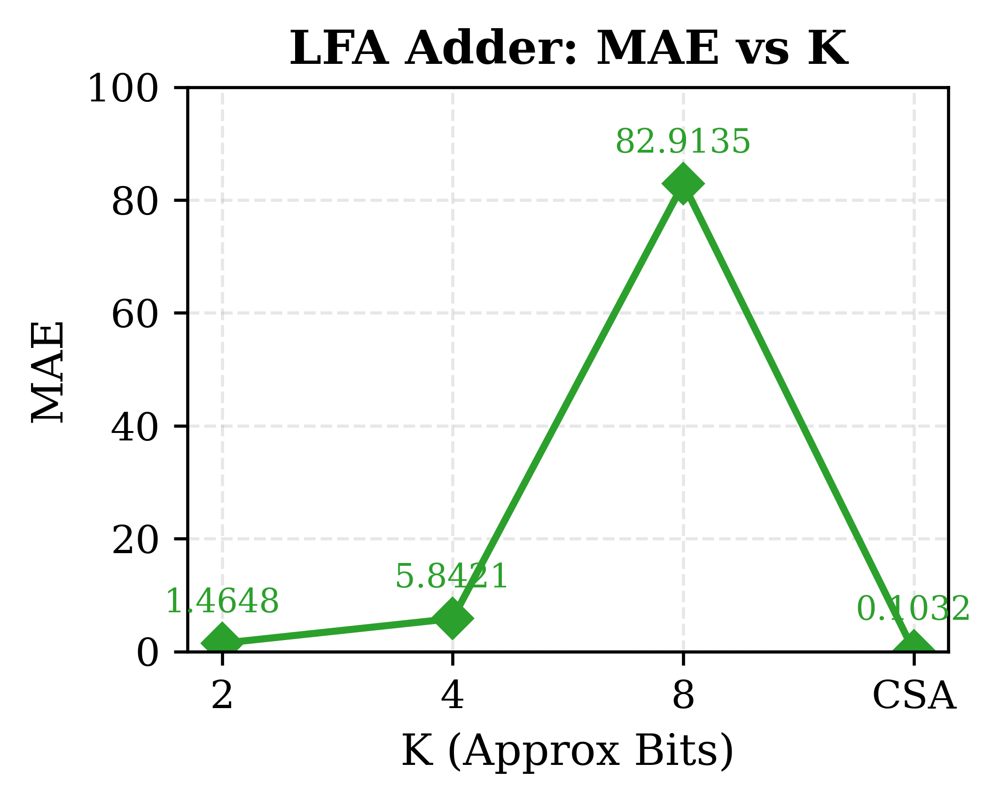 | 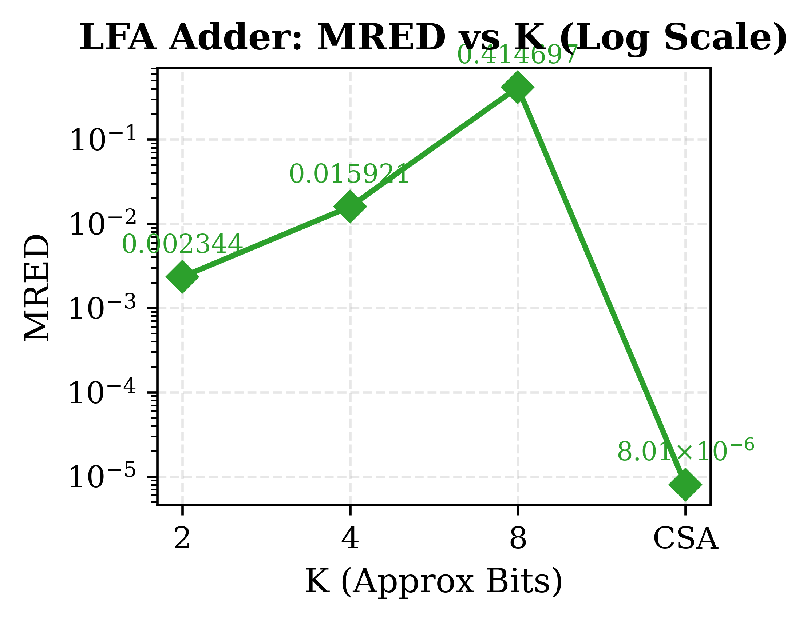 | 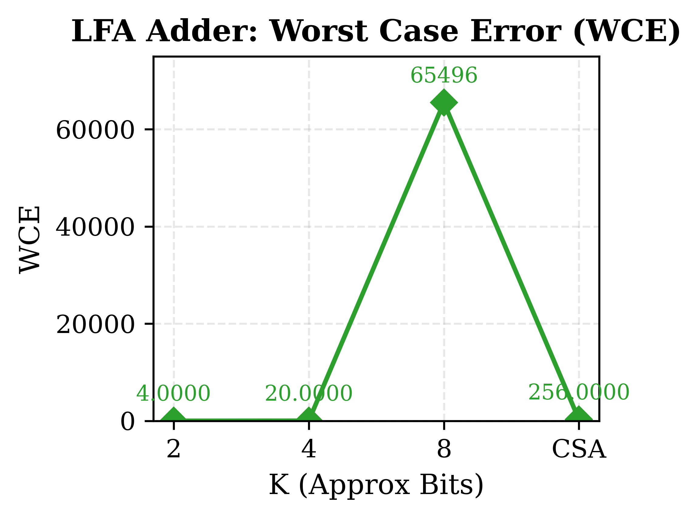 |

## Kogge–Stone

| Error rate | MAE | MRED | Worst-case error |
|---|---|---|---|
| 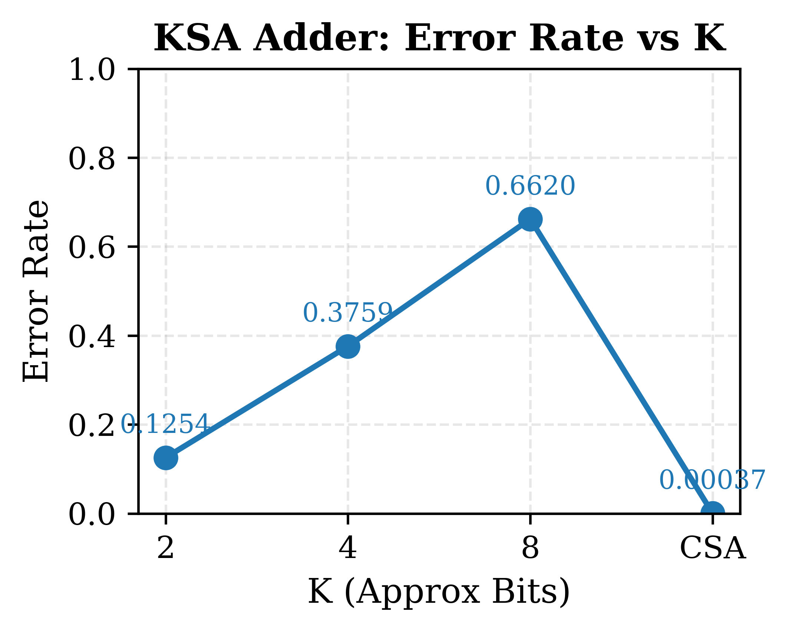 | 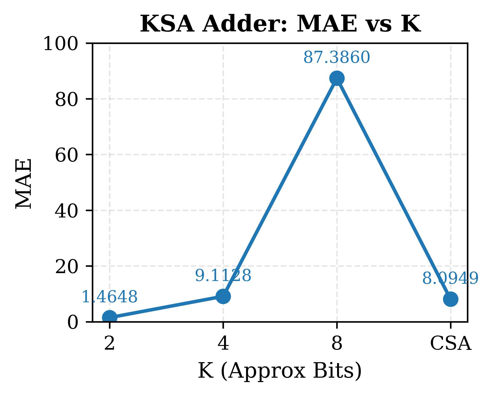 | 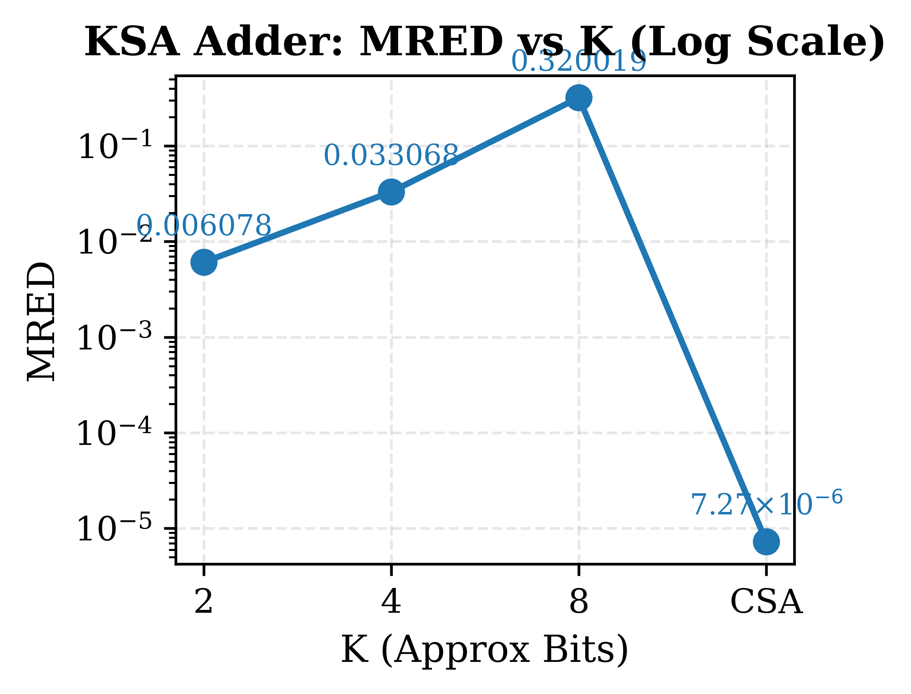 | 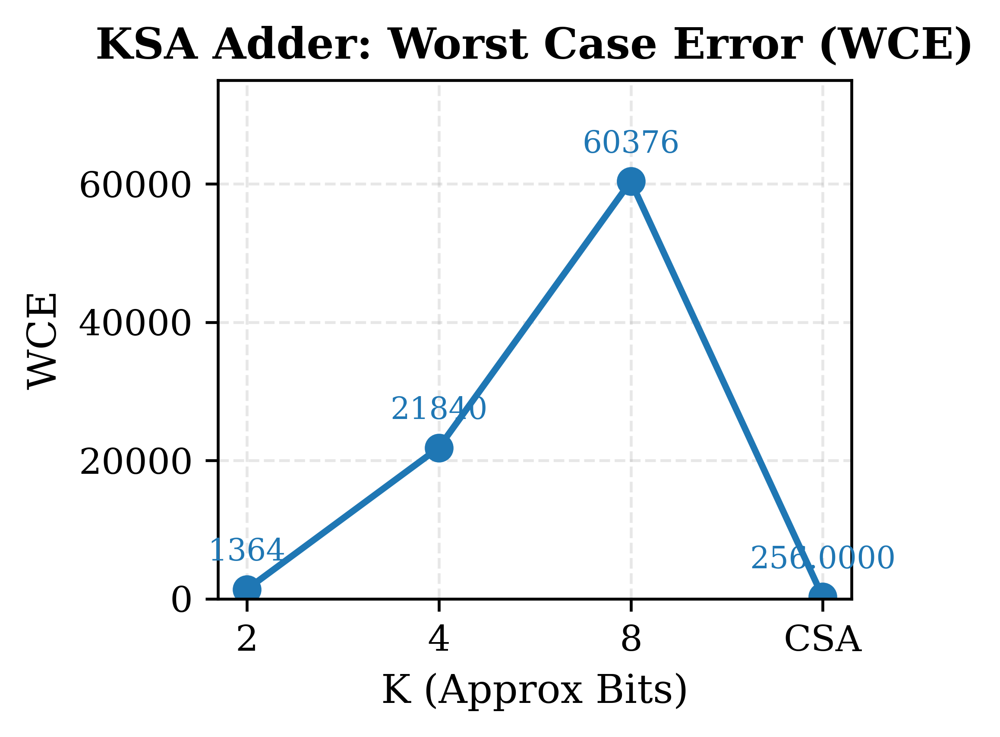 |

## Brent–Kung

| Error rate | MAE | MRED | Worst-case error |
|---|---|---|---|
| 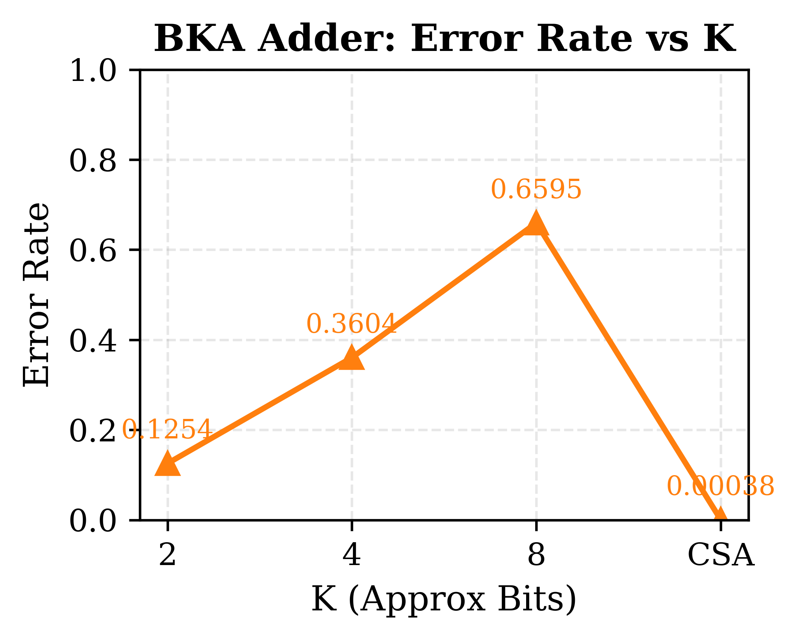 | 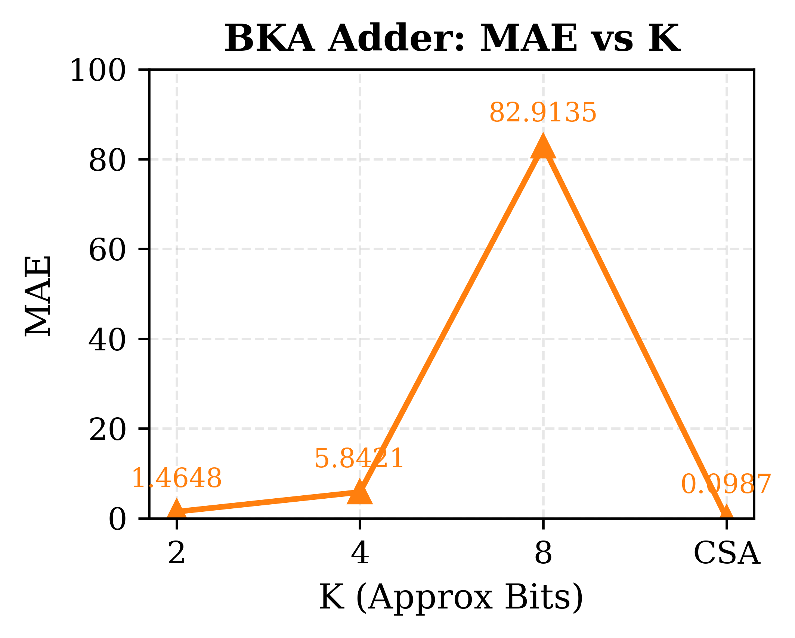 | 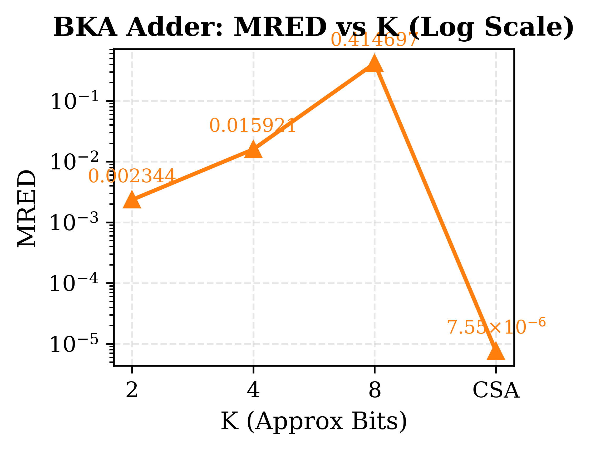 | 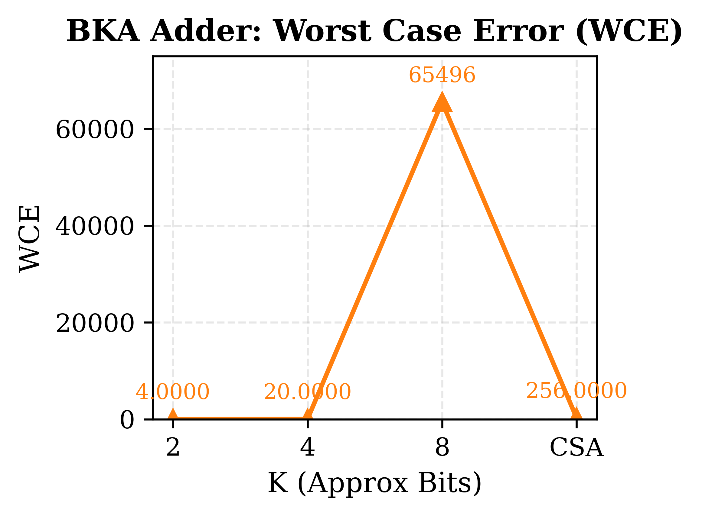 |
