# Reproducible image gallery

The galleries use the same fixed-grayscale source. Rows correspond to the exact, 2-bit, 4-bit, 8-bit and carry-select versions of each architecture. The [per-output quality table](../results/image_demo.csv) contains PSNR and SSIM for all 75 combinations. [Primary target](../image_processing/demo/input.png) · [Second addition input](../image_processing/demo/second-input.png)

## Ladner–Fischer

| Design | Gaussian | Mean | Sobel X | Addition | Brightness |
|---|---|---|---|---|---|
| Exact |  |  |  |  |  |
| 2-bit |  |  | 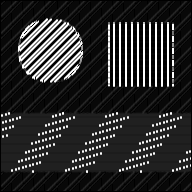 |  |  |
| 4-bit |  |  |  |  |  |
| 8-bit | 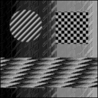 |  |  |  | 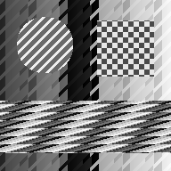 |
| Carry-select |  |  |  |  |  |

## Kogge–Stone

| Design | Gaussian | Mean | Sobel X | Addition | Brightness |
|---|---|---|---|---|---|
| Exact |  |  |  |  |  |
| 2-bit |  | 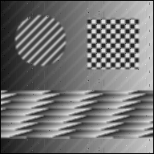 | 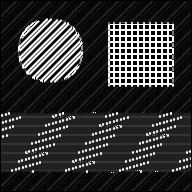 | 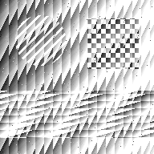 |  |
| 4-bit | 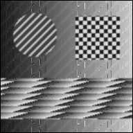 |  | 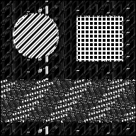 | 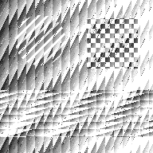 |  |
| 8-bit | 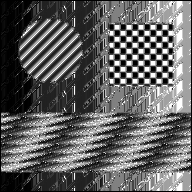 | 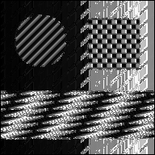 | 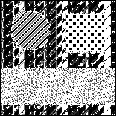 |  |  |
| Carry-select |  |  |  |  |  |

## Brent–Kung

| Design | Gaussian | Mean | Sobel X | Addition | Brightness |
|---|---|---|---|---|---|
| Exact |  |  |  |  |  |
| 2-bit |  |  |  |  |  |
| 4-bit |  |  |  |  | 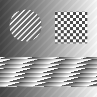 |
| 8-bit |  | 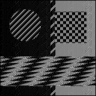 | 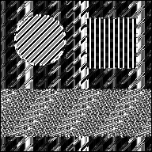 | 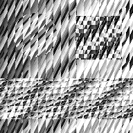 |  |
| Carry-select |  |  |  |  |  |

