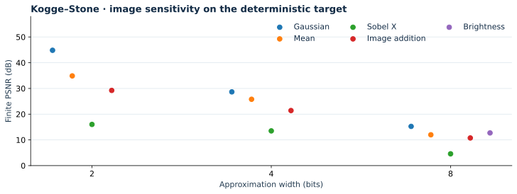

# Image-processing evidence

## Recovered experiments

| Operation | Original MATLAB-only method | Original Verilog file-exchange example | Archived figure coverage |
|---|---|---|---|
| Gaussian | 3×3 integer 1–2–1 separable kernel normalized by 16. Low-bit quantization of accumulated sum or CSA model | Eight approximate additions in row-major order, shift-weighted coefficients, divide-by-16 truncation | LF, KS and BK exact, 2/4/8 and CSA |
| Mean | 3×3 all-ones sum divided by 9. Quantization before division or CSA model | Eight approximate additions, division by 9, streaming image memory | LF, KS and BK exact, 2/4/8 and CSA |
| Horizontal Sobel | Kernel rows `[-1,0,1]`, `[-2,0,2]`, `[-1,0,1]`. Absolute signed response clipped to 255. Quantization or CSA model | Weighted right and left columns, two’s-complement subtraction via the adder, magnitude and clipping | LF, KS and BK exact, 2/4/8 and CSA |
| Image addition | Grayscale pair, resize second input, add, quantize or use CSA model, clip to 255 | Two zero-extended bytes, approximate sum and clipping | Complete LF grid. Additional KS figures without complete baseline linkage |
| Brightness | Add 40, quantize low bits or use CSA model, clip to 255 | No corresponding module recovered | Additional KS and BK figures. The LF brightness directory repeats Gaussian figures |
 
The MATLAB-only filter scripts allocate zero outputs and evaluate interior pixels. They use MATLAB’s cast behavior at image writeout. The mixed examples export 256×256 grayscale text pixels from MATLAB and import simulator output for display. Their historical `approx2` dependency name requires an adapter to the selected recovered top. Some consumers use MATLAB’s column-major reshape after a row-major export. The stored captures do not identify the complete simulation command, operative RTL revision or raw logged image raster. The archive contains no distinct image multiplication implementation. Gaussian weights and Sobel coefficients use small shifts or integer coefficient multiplication.

The private gallery displays the genuine Lena filter captures for all three architectures, the Ladner–Fischer exact and approximate addition series, and Kogge–Stone addition captures labeled 2, 4 and 8 bits. The mixed addition script reads Lena and `rice1.png`. The standalone addition script reads `pout.tif` and `rice.png`, although one title calls the first input Cameraman. Those source references establish intended inputs for the examples. A standalone Rice input raster or verified Cameraman output was unavailable. The supplemental brightness captures show a cat and have an incomplete reference set.

## Arithmetic integration

Historical MATLAB-only `floor(value/2^k)·2^k` clears low output bits of a computed value. The RTL prefix cell instead forwards the higher-index G/P pair at selected nodes. For example, `1+1` with `Cin=0` yields 2 in the 2-bit RTL and 0 under a two-bit output quantizer. The historical MATLAB CSA function uses bit 8 of the operands as an AND predictor and bit 9 of the full low-word sum as a proxy for carry. This differs from the RTL’s `G_final[7]`, which uses the whole lower byte. When the two lower bytes are 127 and 129, their sum carries into bit 8 even though the AND of their most significant bits is zero. Accordingly, keep the MATLAB quantization, MATLAB carry prediction and RTL-conforming experiments individually attributed.

The post-project Python experiment evaluates each output from the same published RTL prefix topology. It uses row-major accumulation, unsigned 16-bit addition, an explicit 16-bit two’s-complement step for Sobel, a zero filter border, floor division for Gaussian and mean, and 8-bit output clipping. Each synthetic input pair is deterministic and generated from the code. CSA uses exact addition at carry-in zero as verified by the replay. The historical file-exchange material establishes simulator-oriented integration. No board measurements or hardware deployment were recovered.

## Quality metrics

Original scripts calculate MAE, MSE, PSNR and SSIM between exact-processed and approximate-processed images. The archived captures contain display titles, margins, resampling and in several cases JPEG encoding. Private review contains the available originals and 40 fixed-crop comparisons for ten complete figure groups. Figures with ambiguous labels or absent exact outputs are inventoried. These values describe display pixels. Raw final-run PSNR and SSIM cannot be recovered from the captures alone.

The demonstration operates directly on raw 8-bit grayscale arrays of equal shape and compares each variant against the exact output of the same operation. MAE averages absolute sample differences, MSE averages squared differences, and RMSE is the square root of MSE. `PSNR = 10 log10(255²/MSE)` and is infinite when MSE is zero. SSIM uses an 11×11 Gaussian window with standard deviation 1.5, population covariance, constants based on 0.01 and 0.03 of peak intensity, and trims five pixels at each boundary before averaging. The independently computed SSIM is identified by these explicit settings. [SSIM authors’ reference](https://ece.uwaterloo.ca/~z70wang/research/ssim/)

The 2-bit LFA Gaussian and Sobel demo clocks 53.54 and 41.79 dB, respectively. At 8 bits they reach 16.14 and 8.87 dB. KSA 8-bit Sobel is 4.59 dB for this target. The brightness increment of 40 produces identical exact and LFA 2-bit/4-bit rasters under the demo’s operand pattern. CSA matches exact for every demo operation because carry-in is zero. These examples quantify sensitivity for a defined workload without requiring a benchmark image license. [Per-run image metrics](../results/image_demo.csv) · [All demonstration images](IMAGE_GALLERY.md)

