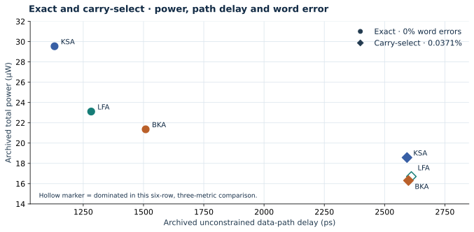

# Archived ASIC synthesis results

## Comparative evidence

The source table was extracted from the archived Genus reports. Power totals are converted from W to µW for display. Area is the library cell-area total. The team’s academic materials identify the technology as 90 nm GPDK and treat area as µm². The comparative report headers provide no independent area-unit declaration or Liberty identifier. Net area is zero in the captured area reports.

| Design label | Cells | Library cell area | Total power (µW) | Data path (ps) | Provenance note |
|---|---:|---:|---:|---:|---|
| LFA exact | 125 | 742.519 | 23.1091 | 1,283 | Top matches recovered RTL |
| LFA 2-bit | 125 | 742.519 | 23.1091 | 1,283 | Report uses exact `ladner` top and duplicates exact metrics |
| LFA 4-bit | 123 | 728.895 | 22.7227 | 1,283 | Summary labels 4-bit, internal report names `LADNER_Approx2` |
| LFA 8-bit | 101 | 590.382 | 18.3451 | 1,284 | Top `ladner_fig8` also occurs in 4-bit RTL |
| LFA CSA | 73 | 494.256 | 16.7044 | 2,611 | Report top matches |
| KSA exact | 161 | 946.882 | 29.5434 | 1,131 | Report top `ksa` differs from recovered top |
| KSA 2-bit | 159 | 935.528 | 29.1476 | 1,134 | Same scalars and top as 4-bit and 8-bit reports |
| KSA 4-bit | 159 | 935.528 | 29.1476 | 1,134 | Same scalars and top as 2-bit and 8-bit reports |
| KSA 8-bit | 159 | 935.528 | 29.1476 | 1,134 | Same scalars and top as 2-bit and 4-bit reports |
| KSA CSA | 83 | 551.023 | 18.5735 | 2,593 | Report top matches |
| BKA exact | 115 | 685.751 | 21.3577 | 1,509 | Report top `BK` differs from recovered top |
| BKA 2-bit | 113 | 672.127 | 20.9690 | 1,479 | Report top matches |
| BKA 4-bit | 107 | 633.525 | 19.7639 | — | Summary lists 1,463 ps. Matching raw path unavailable |
| BKA 8-bit | 107 | 633.525 | 19.7639 | 1,454 | Files named 8-bit identify the 4-bit top |
| BKA CSA | 71 | 482.902 | 16.3082 | 2,599 | Report top matches |

The [parsed report table](../results/genus.csv) preserves source stems, internal tops, separate leakage, internal and switching components, total W, area, path details and exact-baseline percentage changes computed as `100 × (baseline−variant)/baseline`. Dynamic power is internal plus switching. Arithmetic verification establishes the implementation behavior. It cannot prove which RTL revision was submitted to Genus.

## Conditions and path interpretation

- The area and timing headings identify Cadence Genus 21.14-s082_1, slow `balanced_tree`, an enclosed wireload model and timing-library area. The power report identifies `/stim#0/frame#0`. Voltage, temperature, activity settings, mapped netlist identity and full synthesis command sequence are unresolved.
- First paths are flagged `UNCONSTRAINED`. The reported values are combinational data-path delays in ps. They provide no constrained slack, clock period, routed parasitics, board frequency or sign-off timing.
- **LFA.** The exact and 8-bit-labeled paths both start at `B[9]` and end at `Sum[15]` through the upper reduction and distribution logic. The 1 ps change is consistent with preserving the upper carry topology while simplifying low-order cells. The reported total power and area decline by 20.62% and 20.49%. Full source-to-mapping attribution requires a run manifest or clean rerun.
- **KSA.** Exact starts at `B[2]`. The three approximate-labeled reports start at `B[1]` and reach `Sum[15]` with the same 1,134 ps delay. The nominal power decrease is 1.34%. Without distinct design-to-report fingerprints the repeated values cannot isolate width effects.
- **BKA.** Exact and 2-bit paths start at `B[1]` and `B[3]`. The 2-bit report shows 1.99% lower area and delay and 1.82% lower power. The report named 8-bit starts at `B[5]` but identifies `BKapprox4`. All end at `Sum[15]`.
- **Carry-select.** Reported total power drops 27.72% for Ladner–Fischer, 37.13% for Kogge–Stone and 23.64% for Brent–Kung from their respective exact baselines. Path times rise to 2,593–2,611 ps. The recovered upper ripple candidates and selection path offer a plausible structural explanation. BKA CSA has the lowest total power in the comparative archive at 16.3082 µW.

### Report-level Pareto comparison

The three objectives are to minimize reported total power, reported unconstrained data-path delay, and the replayed historical full-word error rate. The comparison covers the six exact and carry-select rows. Within that set, Brent–Kung carry-select dominates Ladner–Fischer carry-select because it has lower power, a shorter path and the same error rate. Kogge–Stone carry-select trades more power for a 6 ps shorter path than Brent–Kung carry-select. These are observed report-level differences. Some exact report top names differ from the recovered names, and no matched post-synthesis netlist fingerprint or timing-significance interval is available. [Pareto input table](../results/carry_select_tradeoffs.csv)

## Earlier Ladner–Fischer report series

The November 2025 LFA reports record 2,589, 2,434, 2,282 and 1,411 ps under the exact/2/4/8 labels. Their totals are 17.2336, 16.2541, 15.4749 and 14.0125 µW. The earliest series has different tops and area values from the comparative archive. The roughly 45.5% exact-to-8-bit timing reduction in the early paper is consistent with that series. The later comparison instead records an essentially unchanged first path. Report labels alone cannot tie every early run to the current RTL. [November 2025 scalar extraction](../results/genus_legacy_lfa.csv)

The missing width-to-report crosswalk also prevents a defensible combined hardware–image-quality frontier. [Reproduction requirements](REPRODUCE.md)
