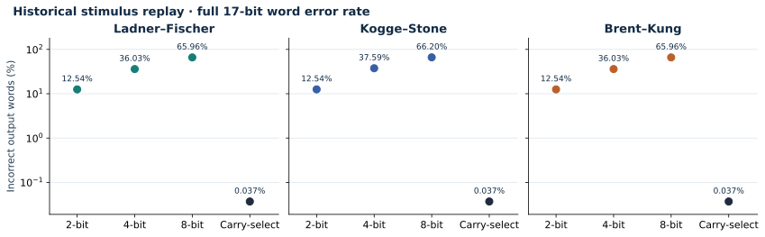

# Arithmetic evidence and simulation

## Historical inputs and counting

Each worksheet contains one header, 75,536 vector rows and the footer `# TOTAL_CASES = 75536`. The same triples appear in the same order in all twelve sheets. The first 65,536 rows enumerate `A,B ∈ [0,255]` with carry-in zero. The final 10,000 look randomized and extend the observed operand ranges to A 0–65,522 and B 0–65,489 across both strata. The historical generator and its seed were unavailable. The full sequence has 75,536 unique pairs and 75,536 unique triples, 5,071 carry-ins of one, 4,965 unsigned 16-bit overflows, and one zero-valued low-word reference.

There are 679,824 width-based output rows and 226,608 CSA-labeled rows, totaling 906,432. Eleven complete sheets containing 830,896 rows reproduce the named configurations. The remaining CSA-labeled sheet duplicates the BKA 4-bit data. Analysis uses all rows when comparing historical file contents. [CSV exports](../datasets/arithmetic) · [Recalculated metrics](../results/arithmetic.csv)

## Metric contract

- The historical reference is `(A+B+Cin) mod 65536`. Every recorded reference matched this integer calculation.
- The historical signed `ED` is `exact−approx`. `AED` is `abs(ED)`. Both columns and every `isError` flag agree with the saved words across all sheets.
- The historical `MRED` column is the per-row absolute relative error ratio `AED/exact`, rounded to six decimal places. The zero-reference row records zero. The summary CSV provides the mean of the recorded column and the recomputed mean over nonzero references.
- Error rate is the fraction of incorrect low words. MAE or mean error distance uses all trials. Worst case in the table is the largest **observed** absolute distance. The supplementary signed bias uses `approx−exact`. MSE, RMSE, population standard deviation, correct-result rate and signed distributions are independently computed. [Signed error histograms](../results/arithmetic_distribution.csv)

The first 65,536 inputs are a designed sweep and dominate the pooled rates. For the 10,000-row tail, LFA/BKA width-based rates are 12.82%, 36.64% and 65.75%. KSA rates are 12.82%, 38.18% and 67.54%. These describe the observed workloads.

## Independent simulation

Icarus Verilog 13.0 ran all 15 RTL configurations over the 75,536 shared historical inputs, 288 directed cases over edge and pattern values, and 4,096 new pseudo-random triples with Python seed `20261127`. The 79,920 stimuli per configuration yield 1,198,800 new evaluations. Three exact designs each produced zero full-output errors. No instance returned X/Z values. The nine width-based models extracted from the prefix RTL, the three exact models, and the CSA arithmetic formula agreed with all captured 17-bit RTL outputs on this suite.

LFA/BKA width-based historical low-word MAEs are 0.501695, 3.506990 and 71.313281. At 8 bits, the observed low-word maximum of 65,496 includes wraparound. KSA exhibits observed low-word maxima of 1,364, 21,840 and 60,376 and fresh full-output maxima of 43,692, 61,168 and 65,280 on the combined suite. These are sampled maxima. [RTL replay summary](../results/rtl_replay.csv)

The BKA CSA workbook is row-identical to BKA 4-bit. The RTL replay diverges from that workbook on 27,244 low words. Replayed BKA/LFA/KSA CSA each yield 28 historical input errors and 46 all-suite errors, all by −256 on the 17-bit word. LFA and KSA CSA worksheets match fresh RTL on every historical input.

### Carry-select output bit errors

An output word counts as incorrect if its 17-bit value differs from exact. The bit denominator is 17 times the number of inputs. The bit numerator sums the population count of `exact ^ carry_select` across the cohort using the arithmetic model verified against every replayed RTL word. In the historical suite each architecture has 28 wrong words out of 75,536 (0.03707%) and 61 wrong bits out of 1,284,112 (0.004750%). All 28 errors occur in the 10,000-case full-width tail, where the word and bit rates are 0.28% and 0.035882%. The exhaustive 8-bit sweep fixes carry-in to zero and produces no carry-select errors. [Output bit and word totals](../results/carry_select_accuracy.csv)

The academic summary uses 75,537 as denominator and reports incompatible LFA/BKA MAEs of 1.4648, 5.8421 and 82.9135. Treat spreadsheet outputs and the fresh replay as the evidence of record for the values above. [Reproduction](REPRODUCE.md)
